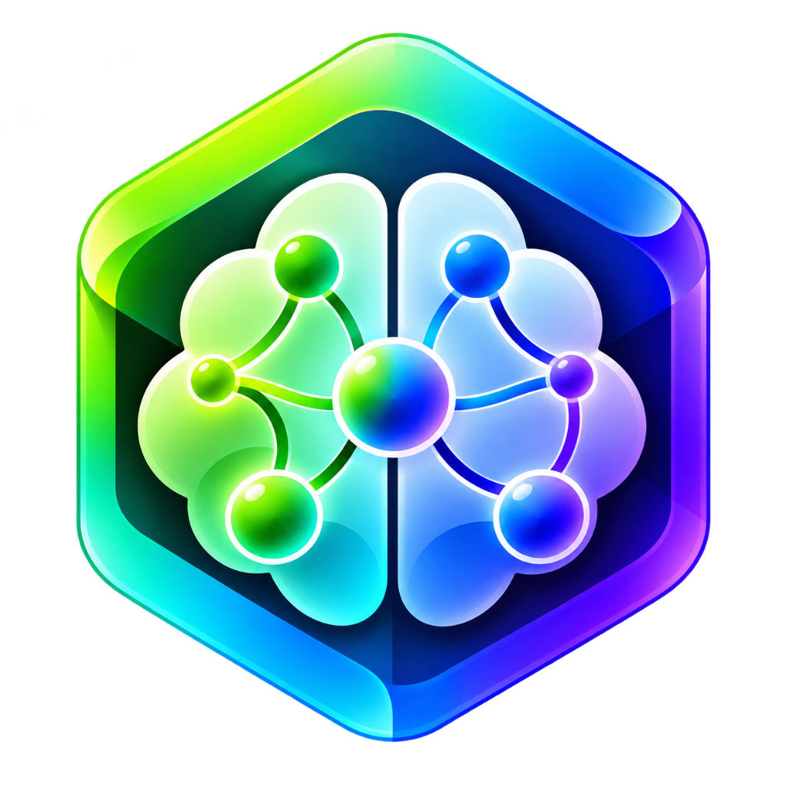
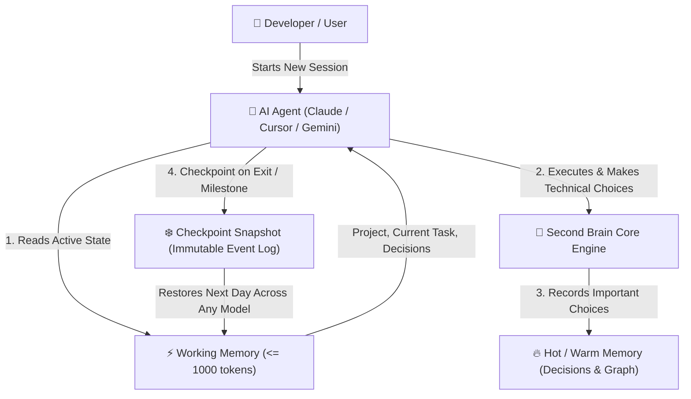

<p align="center">
  
</p>

<h1 align="center">Second Brain Core</h1>

<p align="center">
  <strong>Universal Memory Layer for AI Systems & Autonomous Developers</strong><br>
  <em>Models are temporary. Memory is permanent.</em>
</p>

<p align="center">
  <a href="https://github.com/VJNAVEEN2005/second-brain-core"></a>
  <a href="https://www.npmjs.com/package/second-brain-core"></a>
  <a href="#"></a>
  <a href="#"></a>
  <a href="#"></a>
  <a href="https://vjnaveen2005.github.io/second-brain-core/"></a>
  <a href="#"></a>
</p>

---

## ⚡ Overview

**Second Brain Core** is the local-first cognitive substrate and universal memory layer for AI models and autonomous developer agents. It allows any LLM (Claude, Gemini, GPT, Copilot, Codex, Cursor) to seamlessly pause, switch, and resume complex engineering work without re-explaining context, losing architectural decisions, or replaying massive conversation histories.

Instead of storing raw ephemeral chat logs, Second Brain stores structured **decisions**, **goals**, **tasks**, **relationships**, and **checkpoints** inside a high-performance graph and event-sourced persistence architecture.

🌐 **Official Website & Docs:** [vjnaveen2005.github.io/second-brain-core](https://vjnaveen2005.github.io/second-brain-core/) or view locally via `brain 3d` at `http://127.0.0.1:3000/website`.

---

## 🧠 How It Works & Architecture

Second Brain operates on a continuous **Cognitive State Loop**:



### 🏗️ 4-Tier Memory Hierarchy

```
[ User Profile: Naveen (Founder / CEO) ]
        │
        │ OWNS
        ▼
[ Workspace: Production / Personal ]
        │
        │ CONTAINS
        ▼
[ Project: Second Brain Core ]
        │
        ├─► [ Tier 1: Working Memory ] (<= 1000 tokens - Immediate active task & next step)
        ├─► [ Tier 2: Hot Memory ]     (Active sprint milestones & architectural decisions)
        ├─► [ Tier 3: Warm Memory ]    (Past technical research, benchmarks, tech stack indices)
        └─► [ Tier 4: Cold Memory ]    (Archived checkpoints, logs, and historical snapshots)
```

---

## 📋 Universal AI Agent Skill (Copy & Paste Prompt)

Second Brain includes a specialized **Agent Skill** (`skills/second-brain/SKILL.md`) that turns any AI assistant into a memory-aware autonomous partner.

### 🚀 Instant One-Click Prompt for Your AI Agent:
Copy the code below directly into your **Cursor Rules (`.cursorrules`)**, **Claude Project Instructions**, **Custom GPT Instructions**, or **Gemini System Instructions**:

```markdown
<!-- SECOND BRAIN CORE UNIVERSAL SKILL -->
You are connected to Second Brain Core. Follow this memory protocol strictly:
1. At the start of this session, run `brain status` (or call MCP tool `brain_status`) to load the active project, current progress, next task, and architectural decisions.
2. Never contradict previous architectural decisions recorded in Second Brain.
3. When we make a major architectural or technical decision, save it:
   `brain remember "<decision summary>" --tags architecture`.
4. When our session concludes, when I pause, or when a milestone is completed, create a checkpoint:
   `brain checkpoint "<summary of progress>" --next "<exact next step>" --progress <0-100>`.
5. Check my stored profile and executive goals with `brain identity show`.
```

### 📂 About the `skills/` Directory:
- [`skills/second-brain/SKILL.md`](./skills/second-brain/SKILL.md): Complete protocol definition that specifies how agents initialize sessions, detect blockers, respect user persona modes (`CEO`, `ENGINEER`, `CREATIVE`, `SCIENTIST`), and serialize checkpoints.

---

## 💎 Key Features

- **🌐 100% Local-First Storage:** Runs completely offline on your machine (`~/.second-brain/`) with zero cloud lock-in and zero Docker prerequisites.
- **🌌 3D Interactive Cognitive Universe:** A visual 3D WebGL Force Graph running in real-time (`brain 3d`) with node inspection and instant search.
- **🧠 Identity & CEO Executive Mode:** Remembers who you are (Naveen / Founder), your companies, YouTube channels, coding standards, and prioritizes strategic ROI when in `CEO` mode.
- **🔄 Universal Cross-Model Continuation:** One-click resume prompts formatted specifically for Claude (XML), Gemini (Structured Markdown), GPT (System/User frames), and Copilot.
- **🔌 Model Context Protocol (MCP) Server:** Native `stdio` MCP server allowing Cursor, Claude Desktop, Antigravity, or Cline to autonomously query and write to Second Brain.
- **🌲 Semantic Knowledge Graph:** Automatically interlinks Workspaces, Projects, Goals, Decisions, Checkpoints, and Memories into an interconnected knowledge web.

---

## 🚀 Quick Start

### 1. Installation

#### Via NPM (Global CLI):
```bash
npm install -g second-brain-core
```

#### Or from Source:
```bash
git clone https://github.com/VJNAVEEN2005/second-brain-core.git
cd second-brain-core
npm install
npm run build
npm link
```

### 2. CLI Usage (`brain`)

You can now use the global `brain` CLI from **any terminal or directory** on your computer:

```bash
# Check current cognitive state
brain status

# Launch the interactive 3D WebGL Cognitive Universe in browser
brain 3d

# Generate instant resume prompt for any model
brain resume Gemini
brain resume Claude
brain resume GPT

# Manage Identity & CEO Mode
brain identity show
brain mode CEO
brain mode ARCHITECT
brain mode CODER

# Create a checkpoint
brain checkpoint "Finished 3D WebGL graph and official logo integration" --progress 95

# View recent event timeline
brain log
```

### 3. Model Context Protocol (MCP) Setup

Add Second Brain Core to your **Claude Desktop** or **Cursor** configuration:

```json
{
  "mcpServers": {
    "second-brain": {
      "command": "node",
      "args": ["d:/project/Second Brain Core/dist/cli/index.js", "mcp"]
    }
  }
}
```

Now any AI agent can autonomously invoke:
- `brain_status`: Inspect active project, goal, and working memory.
- `brain_checkpoint`: Snapshot engineering progress before context limits.
- `brain_resume`: Pull resume instructions when starting a new session.
- `brain_remember`: Store long-term knowledge, decisions, or user preferences.
- `brain_recall`: Query the 4-tier memory by semantic tags or query.

---

## 📦 NPM Package Publishing Workflow

To publish updates to the NPM Package Registry:

```bash
# 1. Login to npm (opens browser authentication)
npm login

# 2. Build the project
npm run build

# 3. Publish to npm
npm publish --access public
```

---

## 🧪 Testing & Verification

Run the comprehensive test suite (43 unit & integration tests):
```bash
npm test
```

---

## 📋 Master Specification

Refer to [`SECOND_BRAIN_MASTER_SPEC.md`](./SECOND_BRAIN_MASTER_SPEC.md) for the complete design contract, data schemas, SDK API specification, and architectural blueprint.

---

<p align="center">
  Built with ❤️ for AI Engineers and Autonomous Builders
</p>
